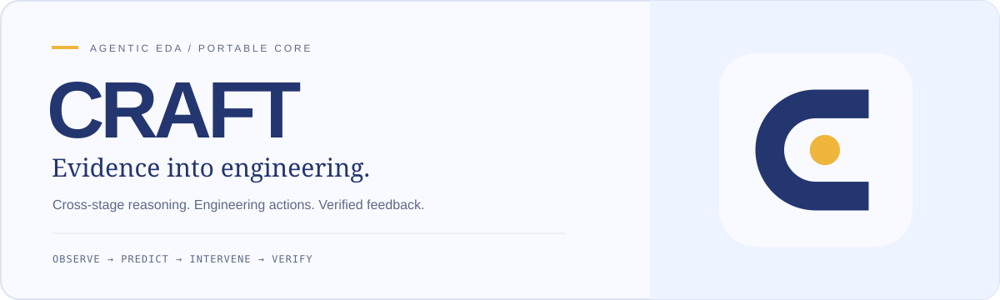
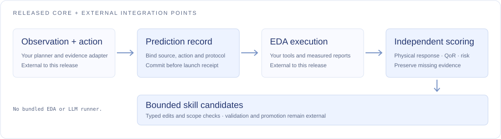

**[🌐 Visit the CRAFT project website →](https://craft2026-11.github.io/craft/)**

<p align="center">
  <a href="https://craft2026-11.github.io/craft/"></a>
</p>

<p align="center"><strong>CRAFT · Agentic EDA Research</strong></p>
<p align="center">Cross-stage reasoning · Engineering actions · Verified feedback · Traceability</p>
<p align="center">
  <a href="https://craft2026-11.github.io/craft/">Project website ↗</a> ·
  <a href="#quick-start">Quick start</a> ·
  <a href="#what-is-released">Released components</a> ·
  <a href="docs/design.md">Design & integration</a> ·
  <a href="docs/paper-protocol.md">Paper protocol</a> ·
  <a href="https://github.com/Craft2026-11/craft">Website repository</a>
</p>



CRAFT is an agentic electronic design automation (EDA) framework that connects evidence from synthesis and physical implementation to diagnostic hypotheses, constrained engineering actions and independently evaluated feedback. Structured records make the decisions and their outcomes inspectable.

**This repository is the initial, partial source release: a portable Python core and an offline demonstration.** It exposes selected research implementation components without requiring a language model, commercial EDA installation, PDK, GPU or network connection. It does not yet contain the complete optimization controller or reproduce the paper's benchmark results.

## What is released

| Component | What you can inspect and reuse |
| --- | --- |
| [Prediction commitment](src/craft_core/commit.py) | Bind predictions to the candidate, source, constraints and evidence scope; create a record before issuing a launch receipt; check identity and content on review. |
| [Independent evaluation](src/craft_core/evaluation.py) | Score supplied physical-response, QoR and constraint-risk forecasts separately, using a protocol bound before execution. |
| [Outcome probabilities](src/craft_core/probability.py) | Three-class beneficial / neutral / harmful forecasts, empirical priors, multiclass Brier scores and abstention accounting. |
| [Bounded skill edits](src/craft_core/skills.py) | Exact scope checks, typed edit allowlists and immutable parent linkage. A proposed edit remains a candidate; promotion is not automated here. |
| [Offline demonstration](src/craft_core/demo.py) | Exercise the modules with explicitly synthetic measurements and write inspectable JSON artifacts. |



The original full research system also includes cross-stage evidence collection, action planning, tool adapters, checkpoint handling and prospective skill validation. These integrations, commercial technology assets, model weights and raw experiment workspaces are outside this release. See [release scope and provenance](docs/release-scope.md).

## Quick start

Python 3.9 or later. The core has **no third-party runtime dependencies**.

```bash
git clone https://github.com/Craft2026-11/craft-project.git
cd craft-project
python3 -m venv .venv
source .venv/bin/activate
python -m pip install .
craft-demo --output demo-output
```

Alternatively, run directly from the checkout without installing the package:

```bash
PYTHONPATH=src python3 -m craft_core.demo --output demo-output
```

Use a new output directory for each run. Existing directories are refused to prevent overwriting records.

Expected summary:

```json
{
  "data_kind": "synthetic_example",
  "physical_response": "supported",
  "qor_prediction": "refuted",
  "missing_evidence": "not_evaluable",
  "skill_revision": "candidate_only",
  "eda_or_llm_executed": false
}
```

The example deliberately shows a physical-response prediction being supported while the QoR prediction is refuted. A second example removes object-continuity evidence and becomes non-evaluable. The measurements are fixtures, not experimental results; the deterministic forecasts are marked as engineering templates and excluded from native-model prediction accuracy.

The output includes the frozen scoring protocol, committed prediction, receipt, synthetic outcome, separate evaluation axes and a bounded skill candidate. [Read the artifact walkthrough](examples/README.md).

## Run the tests

```bash
python -m pip install -e '.[test]'
python -m pytest -q
```

Tests cover commitment ordering, tampering, binding changes, protocol consistency, missing evidence, abstention, evaluation denominators, scope isolation and bounded skill edits. They run without EDA tools or model credentials.

## Research context

The supplied manuscript evaluates three designs—CPU Tile, NoCRouter and RISC-V CPU—using SKY130 and a commercial 28 nm process. The reported per-design time budgets are **8 h, 16 h and 40 h**, respectively. Its action space comprises **46 tool parameters and 6 physical adjustments**.

These describe the full paper experiments, not the offline example above. [The protocol reference](docs/paper-protocol.md) preserves the manuscript's settings and representative parameter candidates. Implementation defaults in this portable core should not be read as an exhaustive specification of the paper experiments.

## Repository layout

```text
assets/              Project icon, README banner and architecture diagram
src/craft_core/      Portable Python components and offline demo
examples/            Demo walkthrough
tests/              Component and integration tests
docs/               Scope, integration contract and manuscript protocol
```

## Website and future releases

- [`craft`](https://github.com/Craft2026-11/craft) is the research website repository.
- `craft-project` is the source repository you are viewing.
- Future releases may add selected tool adapters, curated real-run traces and reproducibility scripts after they are prepared for redistribution. These are not included in version 0.1.0.

For questions about this release, open a [GitHub issue](https://github.com/Craft2026-11/craft-project/issues). Do not attach credentials, private technology files or proprietary design databases.

## License

[MIT](LICENSE), following the license selected for this repository. The code, synthetic example and original SVG artwork in this release are covered by that license. No commercial EDA tools, PDKs or third-party model weights are distributed.
